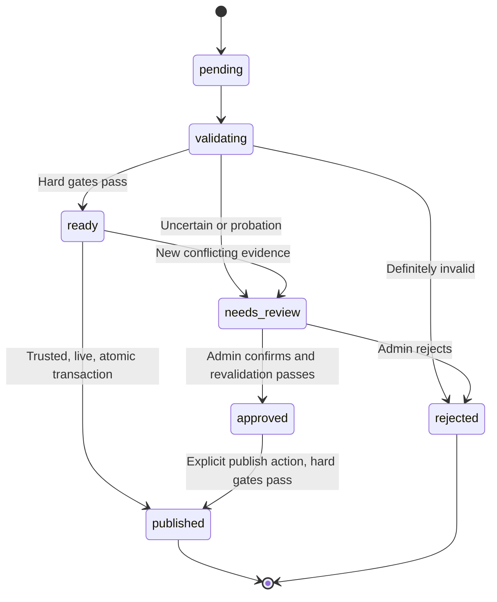
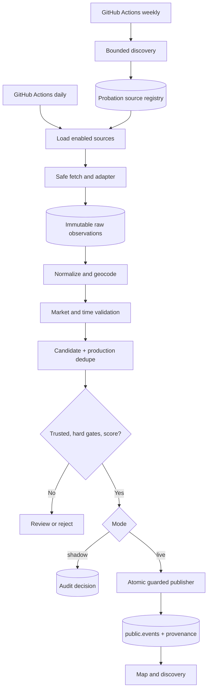

# Floats Automated Event Ingestion — Technical and Schema Specification

- **Version:** 1.0, 2026-11-20
- **Status:** Implementation contract
- **ADR:** `docs/adr/ADR-001-automated-event-ingestion.md`
- **Plan:** `docs/plans/automated-event-ingestion-implementation-plan.md`

## 1. Scope and verified integration constraints

Build daily unattended collection and weekly bounded source discovery for future Charlotte-area qualifying markets. Observations are immutable raw evidence; candidates are canonicalized candidates; only `public.events` contains Floats-visible events. V1 supports verified physical multi-vendor events, not classes/concerts/single-store promotions. No synthetic organizer accounts or unconfirmed recurring instances.

Checked-in Supabase types have `public.events` fields `id uuid`, `title text?`, `description text?`, `starts_at timestamptz`, `ends_at timestamptz`, `address text?`, `latitude float8?`, `longitude float8?`, `event_url text?`, `image_url text?`, `status` enum `draft | published | archived`, `is_market bool?`, `org_id uuid?`, `market_id uuid?`, `series_id uuid?`, `vendor_id uuid?`, `area_id uuid?`. `orgs.owner_id` is mandatory; unclaimed imported events set the first four foreign keys to null. Published map pins require coordinates. The September 2025 `data/schema.sql` snapshot is **not** guaranteed to match live SQL, especially RPCs and triggers. Run an audit before migration.

## 2. Runtime and concrete file map

Node.js 22, TypeScript, Next.js 15 App Router, Supabase, Cheerio, Playwright, Zod, Jest; `tsx` executes CLI scripts. Add runtime packages `cheerio`, `zod`, dev `tsx`; reuse installed `playwright`, `@supabase/supabase-js`, `date-fns`, `date-fns-tz`.

```text
lib/ingestion/config.ts
lib/ingestion/types.ts
lib/ingestion/security/{safe-fetch,url-validation,require-admin,api-errors}.ts
lib/ingestion/adapters/{types,registry,jsonld,ics,html,playwright}.ts
lib/ingestion/adapters/sources/{makers-market-clt,urban-district-market,esther-elsa}.ts
lib/ingestion/{normalize,validation,deduplication,publication,storage,discovery,workers}/
scripts/ingestion/{collect,discover,seed-sources,replay,verify}.ts
app/api/admin/ingestion/{candidates,sources,runs}/
app/admin/ingestion/{candidates,sources,runs}/
components/ingestion/
tests/ingestion/
supabase/migrations/20261120000100_automated_event_ingestion.sql
.github/workflows/{ingestion-daily,ingestion-discovery}.yml
```

Package scripts added without replacing current scripts:

```json
{
  "ingest:daily": "tsx scripts/ingestion/collect.ts",
  "ingest:discover": "tsx scripts/ingestion/discover.ts",
  "ingest:seed": "tsx scripts/ingestion/seed-sources.ts",
  "ingest:replay": "tsx scripts/ingestion/replay.ts",
  "ingest:verify": "tsx scripts/ingestion/verify.ts",
  "test:ingestion": "jest tests/ingestion --runInBand"
}
```

## 3. Configuration and data contracts

### 3.1 Defaults and environment keys

`lib/ingestion/config.ts` exports `INGESTION_DEFAULTS`, `loadIngestionConfig(env?: NodeJS.ProcessEnv): IngestionConfig`. Read at runtime, not import time.

```typescript
export const INGESTION_DEFAULTS = {
  centerLat: 35.2271,
  centerLng: -80.8431,
  radiusMiles: 35,
  horizonDays: 60,
  minVendorCount: 3,
  autoPublishScore: 90,
  reviewScore: 70,
  timezone: "America/New_York",
  publishMode: "shadow",
  httpTimeoutMs: 15000,
  maxResponseBytes: 2097152,
  maxConcurrency: 3,
  maxRedirects: 3,
  maxDiscoveryDepth: 2,
  maxDiscoveryPagesPerSource: 25,
  maxPagesPerSourcePerRun: 100,
  rawRetentionDays: 90,
  runRetentionDays: 365,
  userAgent: "FloatsEventDiscovery/1.0 (+https://findfloats.com)"
} as const;
export type PublishMode = "shadow" | "live";
export interface IngestionConfig {
  centerLat: number; centerLng: number; radiusMiles: number;
  horizonDays: number; minVendorCount: number;
  autoPublishScore: number; reviewScore: number;
  timezone: "America/New_York"; publishMode: PublishMode;
  httpTimeoutMs: number; maxResponseBytes: number;
  maxConcurrency: number; maxRedirects: number;
  maxDiscoveryDepth: number; maxDiscoveryPagesPerSource: number;
  maxPagesPerSourcePerRun: number; rawRetentionDays: number;
  runRetentionDays: number; userAgent: string;
  supabaseUrl: string; supabaseServiceRoleKey: string;
}
```

| Environment variable | Type; validation | Default / requirement |
|---|---|---|
| `INGESTION_CENTER_LAT` | number -90..90 | 35.2271 |
| `INGESTION_CENTER_LNG` | number -180..180 | -80.8431 |
| `INGESTION_RADIUS_MILES` | number 1..100 | 35 |
| `INGESTION_HORIZON_DAYS` | integer 1..365 | 60 |
| `INGESTION_MIN_VENDOR_COUNT` | integer 3..1000 | 3 |
| `INGESTION_AUTO_PUBLISH_SCORE` | integer 70..100 | 90 |
| `INGESTION_REVIEW_SCORE` | integer 0..89, below auto score | 70 |
| `INGESTION_TIMEZONE` | literal `America/New_York` | same |
| `INGESTION_PUBLISH_MODE` | `shadow | live` | shadow |
| `INGESTION_HTTP_TIMEOUT_MS` | integer 1000..60000 | 15000 |
| `INGESTION_MAX_RESPONSE_BYTES` | integer 1024..10485760 | 2097152 |
| `INGESTION_MAX_CONCURRENCY` | integer 1..10 | 3 |
| `INGESTION_USER_AGENT` | nonempty string | default constant |
| `NEXT_PUBLIC_SUPABASE_URL` | HTTPS URL | required for workers |
| `SUPABASE_SERVICE_ROLE_KEY` | nonempty secret | required for workers |

All other default constants above remain code constants for V1; do not invent additional environment flags. Reject invalid configuration before fetching data. Never include the service-role key in errors.

### 3.2 New TypeScript types

`lib/ingestion/types.ts`:

```typescript
export type SourceType = "organizer" | "venue" | "aggregator" | "platform";
export type AdapterType = "jsonld" | "ics" | "html" | "playwright";
export type TrustState = "probation" | "trusted" | "disabled";
export type RunType = "collection" | "discovery" | "replay" | "verification";
export type CandidateStatus = "pending" | "validating" | "ready" | "needs_review" | "approved" | "rejected" | "published";
export type DuplicateState = "unchecked" | "clear" | "possible" | "confirmed";
export type ValidationReason =
  | "invalid_date" | "missing_end_time" | "outside_horizon"
  | "missing_location" | "outside_radius" | "insufficient_vendor_evidence"
  | "excluded_event_type" | "missing_description" | "cancelled"
  | "possible_duplicate" | "confirmed_duplicate" | "untrusted_source"
  | "source_unavailable";
export interface RawEvent {
  sourceId: string;
  externalEventId: string | null;
  sourceUrl: string;
  title: string | null;
  description: string | null;
  startsAt: string | null;
  endsAt: string | null;
  organizerName: string | null;
  venueName: string | null;
  address: string | null;
  vendorCount: number | null;
  evidence: string[];
  categories: string[];
  cancelled: boolean;
  rawPayload: Record<string, unknown>;
}
export interface NormalizedEvent {
  canonicalKey: string;
  title: string;
  description: string | null;
  startsAt: string | null;
  endsAt: string | null;
  timezone: "America/New_York";
  organizerName: string | null;
  venueName: string | null;
  address: string | null;
  latitude: number | null;
  longitude: number | null;
  vendorCount: number | null;
  vendorEvidence: string[];
  categorySlugs: string[];
  cancelled: boolean;
  sourceUrl: string;
}
export interface ValidationResult {
  isMarket: boolean;
  vendorVerified: boolean;
  locationVerified: boolean;
  duplicateState: DuplicateState;
  score: number;
  status: CandidateStatus;
  reasons: ValidationReason[];
}
export interface CollectionResult {
  sourceId: string;
  success: boolean;
  events: RawEvent[];
  discoveredUrls: string[];
  error: string | null;
}
export interface PublicationResult {
  candidateId: string;
  eventId: string | null;
  status: "published" | "shadow" | "blocked";
  reason: string | null;
}
```

`lib/ingestion/adapters/types.ts`:

```typescript
import type { AdapterType, CollectionResult } from "@/lib/ingestion/types";
export interface SourceDefinition {
  id: string; name: string; baseUrl: string;
  adapter: AdapterType; crawlDelayMs: number;
  configuration: Record<string, unknown>;
}
export interface CollectionContext {
  runId: string; now: Date; horizonDays: number; signal: AbortSignal;
}
export interface EventAdapter {
  type: AdapterType;
  collect(source: SourceDefinition, context: CollectionContext): Promise<CollectionResult>;
}
```

## 4. Additive database migration

**Target exact path:** `supabase/migrations/20261120000100_automated_event_ingestion.sql`. Apply only to isolated local Supabase until approved. PostgreSQL `pgcrypto` and PostGIS are expected in Floats; verify existing extensions and schemas. This is the complete baseline DDL including transaction-safe publication. Do not delete any existing table or enum.

```sql
create extension if not exists pgcrypto;
create extension if not exists postgis;
create schema if not exists ingestion;
revoke all on schema ingestion from public, anon, authenticated;
grant usage on schema ingestion to service_role;

create table ingestion.sources (
  id uuid primary key default gen_random_uuid(),
  name text not null,
  base_url text not null unique,
  source_type text not null check (source_type in ('organizer','venue','aggregator','platform')),
  adapter text not null check (adapter in ('jsonld','ics','html','playwright')),
  trust_state text not null default 'probation' check (trust_state in ('probation','trusted','disabled')),
  enabled boolean not null default true,
  discovery_only boolean not null default false,
  crawl_delay_ms integer not null default 2000 check (crawl_delay_ms >= 1000),
  configuration jsonb not null default '{}'::jsonb,
  valid_events integer not null default 0,
  rejected_events integer not null default 0,
  failed_runs integer not null default 0,
  successful_runs integer not null default 0,
  last_success_at timestamptz,
  last_attempt_at timestamptz,
  created_at timestamptz not null default now(),
  updated_at timestamptz not null default now()
);
create table ingestion.runs (
  id uuid primary key default gen_random_uuid(),
  run_type text not null check (run_type in ('collection','discovery','replay','verification')),
  status text not null default 'running' check (status in ('running','succeeded','partial','failed')),
  started_at timestamptz not null default now(),
  finished_at timestamptz,
  sources_attempted integer not null default 0,
  sources_succeeded integer not null default 0,
  observations_found integer not null default 0,
  candidates_created integer not null default 0,
  candidates_published integer not null default 0,
  candidates_review integer not null default 0,
  error_summary text,
  metadata jsonb not null default '{}'::jsonb,
  check (finished_at is null or finished_at >= started_at)
);
create table ingestion.observations (
  id uuid primary key default gen_random_uuid(),
  source_id uuid not null references ingestion.sources(id),
  run_id uuid not null references ingestion.runs(id),
  external_event_id text,
  source_url text not null,
  raw_payload jsonb not null,
  content_hash text not null check (content_hash ~ '^[0-9a-f]{64}$'),
  parser_version text not null,
  observed_at timestamptz not null default now(),
  unique (source_id, source_url, content_hash)
);
create table ingestion.candidates (
  id uuid primary key default gen_random_uuid(),
  primary_source_id uuid not null references ingestion.sources(id),
  canonical_key text not null unique check (canonical_key ~ '^[0-9a-f]{64}$'),
  source_url text not null,
  external_event_id text,
  title text not null,
  description text,
  starts_at timestamptz,
  ends_at timestamptz,
  timezone text not null default 'America/New_York' check (timezone = 'America/New_York'),
  organizer_name text,
  venue_name text,
  address text,
  latitude double precision check (latitude is null or latitude between -90 and 90),
  longitude double precision check (longitude is null or longitude between -180 and 180),
  category_slugs text[] not null default '{}'::text[],
  vendor_count integer check (vendor_count is null or vendor_count >= 0),
  vendor_evidence jsonb not null default '[]'::jsonb,
  validation_reasons jsonb not null default '[]'::jsonb,
  score integer not null default 0 check (score between 0 and 100),
  is_market boolean not null default false,
  location_verified boolean not null default false,
  vendor_verified boolean not null default false,
  cancelled boolean not null default false,
  duplicate_state text not null default 'unchecked'
    check (duplicate_state in ('unchecked','clear','possible','confirmed')),
  status text not null default 'pending'
    check (status in ('pending','validating','ready','needs_review','approved','rejected','published')),
  manual_override boolean not null default false,
  approved_by uuid references auth.users(id),
  published_event_id uuid unique references public.events(id),
  first_seen_at timestamptz not null default now(),
  last_seen_at timestamptz not null default now(),
  updated_at timestamptz not null default now(),
  check (ends_at is null or starts_at is null or ends_at > starts_at)
);
create table ingestion.candidate_sources (
  candidate_id uuid not null references ingestion.candidates(id) on delete cascade,
  observation_id uuid not null references ingestion.observations(id) on delete cascade,
  match_reason text not null,
  created_at timestamptz not null default now(),
  primary key (candidate_id, observation_id)
);
create table ingestion.source_discoveries (
  id uuid primary key default gen_random_uuid(),
  discovered_url text not null unique,
  parent_source_id uuid references ingestion.sources(id),
  evaluation text not null default 'pending'
    check (evaluation in ('pending','compatible','unsupported','restricted','rejected')),
  reason text,
  adapter_detected text check (adapter_detected is null or adapter_detected in ('jsonld','ics','html','playwright')),
  registered_source_id uuid references ingestion.sources(id),
  discovered_at timestamptz not null default now(),
  evaluated_at timestamptz
);
create table ingestion.reviews (
  id uuid primary key default gen_random_uuid(),
  candidate_id uuid not null references ingestion.candidates(id),
  reviewer_id uuid not null references auth.users(id),
  decision text not null check (decision in ('approve','reject','request_review')),
  reason text not null check (length(trim(reason)) > 0),
  changes jsonb not null default '{}'::jsonb,
  created_at timestamptz not null default now()
);
create table ingestion.publication_audit (
  id uuid primary key default gen_random_uuid(),
  candidate_id uuid not null references ingestion.candidates(id),
  event_id uuid references public.events(id),
  action text not null check (action in ('shadow_approved','published','skipped_duplicate','blocked','archived')),
  reason text,
  details jsonb not null default '{}'::jsonb,
  created_at timestamptz not null default now()
);
create table public.event_ingestion_links (
  event_id uuid primary key references public.events(id) on delete cascade,
  candidate_id uuid not null unique references ingestion.candidates(id),
  source_id uuid not null references ingestion.sources(id),
  organizer_display_name text,
  management_state text not null default 'ingestion' check (management_state in ('ingestion','manual','claimed')),
  created_at timestamptz not null default now(),
  updated_at timestamptz not null default now()
);

create index idx_sources_trust_enabled on ingestion.sources(trust_state,enabled);
create index idx_runs_started_at on ingestion.runs(started_at desc);
create index idx_observations_source_observed on ingestion.observations(source_id,observed_at desc);
create index idx_candidates_status_score on ingestion.candidates(status,score desc);
create index idx_candidates_starts_at on ingestion.candidates(starts_at);
create index idx_candidates_source on ingestion.candidates(primary_source_id);
create index idx_candidates_location on ingestion.candidates(latitude,longitude);
create index idx_candidate_sources_observation on ingestion.candidate_sources(observation_id);
create index idx_reviews_candidate on ingestion.reviews(candidate_id,created_at desc);
create index idx_audit_candidate on ingestion.publication_audit(candidate_id,created_at desc);
create index idx_ingestion_links_source on public.event_ingestion_links(source_id);

alter table ingestion.sources enable row level security;
alter table ingestion.runs enable row level security;
alter table ingestion.observations enable row level security;
alter table ingestion.candidates enable row level security;
alter table ingestion.candidate_sources enable row level security;
alter table ingestion.source_discoveries enable row level security;
alter table ingestion.reviews enable row level security;
alter table ingestion.publication_audit enable row level security;
alter table public.event_ingestion_links enable row level security;
revoke all on all tables in schema ingestion from public,anon,authenticated;
revoke all on public.event_ingestion_links from public,anon,authenticated;
grant select,insert,update,delete on all tables in schema ingestion to service_role;
grant select,insert,update,delete on public.event_ingestion_links to service_role;

-- This function is invoked ONLY by a trusted service-role backend.
-- Manual approval must first be recorded by an authenticated admin API.
create or replace function ingestion.publish_candidate(
  p_candidate_id uuid,
  p_min_score integer,
  p_center_lat double precision,
  p_center_lng double precision,
  p_radius_miles double precision,
  p_horizon_days integer,
  p_manual boolean default false
)
returns uuid language plpgsql security definer set search_path = ''
as $$
declare
  v ingestion.candidates%rowtype;
  s ingestion.sources%rowtype;
  existing_id uuid;
  new_id uuid;
  v_now timestamptz := now();
begin
  if p_min_score not between 70 and 100
     or p_radius_miles not between 1 and 100
     or p_horizon_days not between 1 and 365
     or p_center_lat not between -90 and 90
     or p_center_lng not between -180 and 180 then
    raise exception 'Invalid publication configuration';
  end if;

  -- Lock the event identity, NOT only the candidate UUID.
  select * into v from ingestion.candidates where id = p_candidate_id;
  if not found then raise exception 'Candidate not found'; end if;
  perform pg_catalog.pg_advisory_xact_lock(
    pg_catalog.hashtextextended(v.canonical_key, 0)
  );
  select * into v from ingestion.candidates where id = p_candidate_id for update;
  if v.published_event_id is not null then return v.published_event_id; end if;

  select * into s from ingestion.sources where id = v.primary_source_id;
  if not found or not s.enabled or s.trust_state = 'disabled' then
    raise exception 'Source unavailable';
  end if;
  if p_manual then
    if v.status <> 'approved' or v.approved_by is null then
      raise exception 'Candidate requires recorded admin approval';
    end if;
  else
    if s.trust_state <> 'trusted' or v.status <> 'ready' or v.score < p_min_score then
      raise exception 'Automatic publication not permitted';
    end if;
  end if;

  if pg_catalog.length(pg_catalog.btrim(v.title)) < 5
     or v.description is null
     or pg_catalog.length(pg_catalog.btrim(v.description)) < 20
     or v.address is null
     or pg_catalog.length(pg_catalog.btrim(v.address)) < 10
     or v.starts_at is null or v.ends_at is null
     or v.ends_at <= v.starts_at
     or v.starts_at < v_now
     or v.starts_at >= v_now + pg_catalog.make_interval(days => p_horizon_days)
     or v.latitude is null or v.longitude is null
     or not v.location_verified or not v.vendor_verified
     or not v.is_market or v.cancelled
     or v.duplicate_state <> 'clear' then
    raise exception 'Candidate failed hard publication gates';
  end if;
  if not public.ST_DWithin(
    public.ST_SetSRID(public.ST_MakePoint(v.longitude,v.latitude),4326)::public.geography,
    public.ST_SetSRID(public.ST_MakePoint(p_center_lng,p_center_lat),4326)::public.geography,
    p_radius_miles * 1609.344
  ) then raise exception 'Event is outside radius'; end if;

  -- Protect even when distinct candidates share the same identity.
  select l.event_id into existing_id
  from public.event_ingestion_links l
  join ingestion.candidates c on c.id = l.candidate_id
  where c.canonical_key = v.canonical_key
  limit 1;
  if existing_id is not null then
    raise exception 'Existing published event identity';
  end if;

  -- Conservative exact match with pre-existing manually entered events.
  -- A richer fuzzy match MUST have completed at candidate validation.
  if exists (
    select 1 from public.events e
    where e.status <> 'archived'
      and e.starts_at between v.starts_at - interval '2 hours'
                          and v.starts_at + interval '2 hours'
      and pg_catalog.lower(pg_catalog.btrim(e.title)) =
          pg_catalog.lower(pg_catalog.btrim(v.title))
      and pg_catalog.lower(pg_catalog.btrim(e.address)) =
          pg_catalog.lower(pg_catalog.btrim(v.address))
  ) then raise exception 'Possible existing production duplicate'; end if;

  insert into public.events (
    title,description,starts_at,ends_at,address,latitude,longitude,
    event_url,image_url,status,is_market,is_featured,
    org_id,vendor_id,market_id,series_id
  ) values (
    v.title,v.description,v.starts_at,v.ends_at,v.address,v.latitude,v.longitude,
    v.source_url,null,'draft',true,false,null,null,null,null
  ) returning id into new_id;

  insert into public.event_ingestion_links (
    event_id,candidate_id,source_id,organizer_display_name,management_state
  ) values (new_id,v.id,s.id,v.organizer_name,'ingestion');

  insert into public.event_categories(event_id,category_id)
  select new_id,c.id from public.categories c
  where c.slug = any(v.category_slugs)
  on conflict do nothing;

  update public.events set status = 'published' where id = new_id;
  update ingestion.candidates set
    status = 'published',published_event_id = new_id,updated_at = now()
  where id = v.id;
  insert into ingestion.publication_audit(candidate_id,event_id,action,reason)
  values (v.id,new_id,'published',case when p_manual then 'manual_approval' else 'trusted_source' end);
  return new_id;
end;
$$;
revoke all on function ingestion.publish_candidate(
  uuid,integer,double precision,double precision,double precision,integer,boolean
) from public,anon,authenticated;
grant execute on function ingestion.publish_candidate(
  uuid,integer,double precision,double precision,double precision,integer,boolean
) to service_role;
```

**Required migration reconciliation before execution:** Supabase PostGIS functions may be installed in `extensions` instead of `public`. Inspect `pg_extension.extnamespace`, and consistently schema-qualify `ST_DWithin`, `ST_SetSRID`, `ST_MakePoint`, and `geography` with the actual installed schema. In the SQL above, `public` is the baseline expected schema **only when verified**. Likewise inspect event insertion triggers, `public.event_categories` uniqueness, event status enum and notification side effects. Never change unrelated existing objects to make this migration pass. The SQL publisher is an explicit V1 baseline, but production activation is blocked until identity races against *different normalized keys for the same physical event* have been tested and resolved by fuzzy preflight/manual review or an additional canonical identity lock scheme. A simple hash cannot resolve all cross-source duplicates.

### 4.1 Why publication is still guarded by application validation

The SQL function enforces immutable hard gates, trusted source and atomic writes. Candidate-level validation also performs source-text evidence assessment, geocoding, richer deduplication and source-staleness checks. A score or hard gate stored on the candidate is only trustworthy if updated through server-only processing. The service-role credential therefore must not be shared with untrusted processes or external clients.

### 4.2 Source trust evidence

Derive counts of manually verified qualifying candidates from `ingestion.reviews` joined to `ingestion.candidates`, grouped by source, counting distinct candidate IDs with `decision='approve'`; do **not** trust a user-supplied counter. Promotion also requires three successfully completed source collections (per-source evidence), not merely three global runs. `sources.successful_runs` is updated once per successful source attempt. Initial seeds always probation.

## 5. Source catalog and collection

Seed only sources whose applicable access terms permit automated fetching. These initial entries are to be validated during TASK-06:

```json
[
  {"name":"Makers Market CLT","base_url":"https://www.makersmarketclt.com/markets","source_type":"organizer","adapter":"html","trust_state":"probation","enabled":true,"discovery_only":false},
  {"name":"Urban District Market","base_url":"https://www.udmmilldistrict.com/calendar","source_type":"venue","adapter":"html","trust_state":"probation","enabled":true,"discovery_only":false},
  {"name":"Esther and Elsa","base_url":"https://www.estherandelsaretail.com/frontporchclt","source_type":"organizer","adapter":"html","trust_state":"probation","enabled":true,"discovery_only":false}
]
```

Prefer JSON-LD `Event` and `@graph` first, explicit ICS `VEVENT` next, static event page/card selectors, then Playwright permitted rendering. Collect event `sourceUrl`, stable ID, title/description, organizer, venue, address, date/time, cancellation signals, vendor evidence and raw structured payload. No guessed end times. Mark parser structural mismatch as failure rather than a zero-event success. Recurrence patterns only schedule source rechecks; publish a particular occurrence only if explicitly confirmed.

### 5.1 Safe fetch contract

`lib/ingestion/security/safe-fetch.ts`:

```typescript
export interface SafeFetchOptions {
  timeoutMs: number; maxResponseBytes: number; maxRedirects: number; userAgent: string;
}
export interface SafeFetchResult {
  finalUrl: string; status: number; contentType: string; body: string;
  etag: string | null; lastModified: string | null;
}
export async function safeFetch(url: string, options: SafeFetchOptions): Promise<SafeFetchResult>;
```

Allow HTTP/HTTPS only. Reject embedded URL credentials, localhost, RFC1918/private, loopback, unspecified, link-local, multicast and cloud metadata IPv4/IPv6. Enforce DNS resolution **and connection pinning** or equivalent dispatcher-level validation to stop DNS rebinding; revalidate redirects. Stream with size cap, reject wrong content type, enforce timeout, rate limit per origin, honor robots and access rules, limit crawling depth and pages. No arbitrary URLs from browser requests and no CAPTCHA/auth bypass.

### 5.2 Discovery contract

`discoverSources(runId: string): Promise<{discovered:number;compatible:number;registered:number;unsupported:number}>`: traverse known-source outbound organizer/venue links, public event feeds and sitemaps to depth <=2, <=25 discovery pages per originating source; canonicalize tracking query parameters away; check access and adapter compatibility; register compatible sources only in probation; record unsupported/restricted discoveries and reasons. This is an autonomous **known-graph discovery** V1, not paid web search.

## 6. Normalization, validation and identity

### 6.1 Normalization

`normalizeEvent(raw: RawEvent, now: Date): NormalizedEvent`; `generateCanonicalKey(event): string`; `normalizeSourceUrl(url)`; `normalizeAddress(address)`.

- Unicode normalize, trim and collapse whitespace, remove HTML safely without inventing prose, canonicalize URLs, preserve evidence and the original source reference.
- Parse with explicit `America/New_York`, convert to UTC. Ambiguous DST times with no offset, invalid dates and missing end times fail auto-publication; missing values remain null.
- `canonicalKey` = lowercased SHA-256 hex of the deterministic string `normalized_title|normalized_address_or_venue|YYYY-MM-DD_in_America/New_York`. Source external IDs are used for **observation** identity, not cross-source canonical identity. Similar-but-different titles are resolved by matcher, never blindly hashed together.
- Date eligibility: `now <= startsAt < now + horizonDays`, `endsAt > startsAt`; compute with real UTC instants.

### 6.2 Geocoding

`geocodeAddress(address: string): Promise<{latitude:number;longitude:number;formattedAddress:string;provider:string;verified:boolean}|null>`; `isWithinRadius(lat,lng,config): boolean`. Check existing compliant Floats geocoder and cache normalized known addresses. No new paid geocoder is authorized in V1. If not configured, unresolved candidates enter review and live publishing stays blocked; never invent coordinates. PostGIS geography distance remains authoritative; radiusMeters = radiusMiles * 1609.344.

### 6.3 Market class and scoring

Positive context: makers market, artisan market, vendor market, vintage market, craft fair, flea market, farmers market, holiday market, shop local, pop-up market. Negative context: yoga-only, workshop-only, karaoke, trivia, single-store promotions, concert-only, networking-only. A valid market featuring live music is **not** excluded.

Vendor verification: explicit >=3 independent vendors, or a roster showing >=3, or a trusted organizer's documented established multi-vendor format tied to that event. Unknown vendor count alone does not imply three. Hard gates: valid description >=20 characters, title >=5, address >=10, location verified, future start/end, within radius, qualifying vendor evidence, not cancelled, `duplicateState='clear'`.

Score exactly 100 possible points: source reliability 0–25, vendor evidence 0–30, date/time 0–20, geolocation 0–15, event-type classification 0–10. >=90 trusted+all hard gates → ready; 70–89 or probation/possible duplicate/recoverable missing info → needs_review; clearly excluded/expired/cancelled/confirmed duplicate → rejected. Manual approval bypasses source trust and numeric score only; never hard gates. Weight subrules must be deterministic and covered by fixtures; do not claim probabilities from scores.

### 6.4 Deduplication

`findDuplicate(event: NormalizedEvent): Promise<{candidateId:string|null;eventId:string|null;confidence:number;reason:string}|null>`. Compare exact observation IDs and URLs first, canonical key, organizer/venue/date, normal title similarity, geospatial proximity and **all** `public.events`, including manually created ones. Confidence >=0.95 confirmed, 0.75–<0.95 possible, <0.75 no automatic match (thresholds heuristic, not statistically calibrated). Return evidence. Different recurrences on different dates are separate instances. Before publishing, recheck production state while holding canonical-identity transaction lock. Ambiguous fuzzy matches never automatically publish.

### 6.5 Candidate state machine



Repeated observations update `last_seen_at` and links, never reset approved/published state or overwrite manual overrides. Reviews and publication have audited transactional state transitions. Rejected candidates may re-open only with material new evidence or explicit admin action.

## 7. Publisher and ownership contracts

`publishCandidate(candidateId: string, manual: boolean): Promise<PublicationResult>` uses the restricted SQL function via a server-only service-role client; `recordShadowDecision` appends `shadow_approved` audit without writing production. Automatic path requires live mode, trusted+ready, score >=90 and all hard gates. Explicit administrator-approved manual publication can be invoked while automatic shadow mode is active, but must separately check admin and all hard gates.

Atomic transaction: validate → identity lock → candidate lock → source trust and hard gates → existing-production duplicate check → insert `public.events` draft with null owner/vendor/market/series → insert provenance → associate existing categories → publish event → mark candidate published → audit → commit. Failure rolls back all writes. A repeat returns the existing event ID. Do not use the existing user-facing event creation route.

For subsequent updates: only `event_ingestion_links.management_state='ingestion'` can be modified, never host/claimed/manual; recheck link/ownership transactionally; update only verified title, description, times, address, coordinates; archive only on explicit verified cancellation and after checking notification side effects. Source 404 or temporary disappearance is not cancellation. Changing a producer-owned event to `manual` or `claimed` disables automated updates immediately.

## 8. REST API (admin-only)

All routes require a verified Supabase user session **and** `public.app_admins` membership; elevated clients instantiated after authorization. Schema access is server-only. Use Zod for inputs. JSON error shape:

```json
{"ok":false,"error":{"code":"VALIDATION_ERROR","message":"Request validation failed"}}
```

Error HTTP mapping: `UNAUTHORIZED` 401; `FORBIDDEN` 403; `VALIDATION_ERROR` 400; `NOT_FOUND` 404; `CONFLICT` 409; `INTERNAL_ERROR` 500. Never return raw SQL traces or secrets.

### `GET /api/admin/ingestion/candidates?status=needs_review&limit=25&cursor=`

Query `status` optional CandidateStatus, `limit` default 25 max 100, `cursor` opaque base64url representing `(updated_at,id)`. Order `updated_at DESC,id DESC`; no unbounded offsets. Example 200:

```json
{"ok":true,"data":[{"id":"11111111-1111-4111-8111-111111111111","title":"Charlotte Makers Market","starts_at":"2026-12-05T15:00:00Z","ends_at":"2026-12-05T20:00:00Z","address":"Charlotte, NC","organizer_name":"Example Organizer","source_url":"https://example.org/markets/5","score":82,"status":"needs_review","validation_reasons":["untrusted_source"],"duplicate_state":"clear","published_event_id":null}],"next_cursor":null}
```

### `GET /api/admin/ingestion/candidates/{id}`

200 example:

```json
{"ok":true,"data":{"id":"11111111-1111-4111-8111-111111111111","title":"Charlotte Makers Market","description":"A multi-vendor market featuring local makers.","starts_at":"2026-12-05T15:00:00Z","ends_at":"2026-12-05T20:00:00Z","timezone":"America/New_York","address":"Charlotte, NC","latitude":35.2271,"longitude":-80.8431,"vendor_count":null,"vendor_evidence":["Established organizer format confirmed"],"score":82,"status":"needs_review","source_url":"https://example.org/markets/5","validation_reasons":["untrusted_source"],"sources":[{"source_url":"https://example.org/markets/5","match_reason":"primary"}]}}
```

Coordinates and listing are fictional **test values**, not verified real events.

### `PATCH /api/admin/ingestion/candidates/{id}`

Allowed actions `approve | reject | request_review`; `reason` required nonempty; editable keys only `title,description,starts_at,ends_at,address,organizer_name,venue_name,latitude,longitude,category_slugs,vendor_count`. Example:

```json
{"action":"approve","reason":"Organizer and dates verified","changes":{"title":"Charlotte Makers Market","description":"A multi-vendor market featuring local makers."}}
```

200:

```json
{"ok":true,"candidate_id":"11111111-1111-4111-8111-111111111111","status":"approved","published_event_id":null}
```

In one transaction: lock candidate, validate patch and status transition, save review with real admin ID, revalidate and deduplicate, update candidate. **Approval never publishes implicitly.** Reject approval if hard gates unresolved; rejection/request_review may retain unresolved facts.

### `POST /api/admin/ingestion/candidates/{id}/publish`

Request:

```json
{"manual":true}
```

200:

```json
{"ok":true,"candidate_id":"11111111-1111-4111-8111-111111111111","event_id":"22222222-2222-4222-8222-222222222222","status":"published"}
```

`manual=true` only; admin-approved status plus hard gates required. No publicly callable worker publish endpoint.

### `GET /api/admin/ingestion/sources`

200:

```json
{"ok":true,"data":[{"id":"33333333-3333-4333-8333-333333333333","name":"Example Organizer","base_url":"https://example.org/markets","source_type":"organizer","adapter":"html","trust_state":"probation","enabled":true,"valid_events":0,"rejected_events":0,"successful_runs":0,"failed_runs":0,"last_success_at":null}]}
```

### `PATCH /api/admin/ingestion/sources/{id}`

Request:

```json
{"trust_state":"trusted","enabled":true}
```

200:

```json
{"ok":true,"source_id":"33333333-3333-4333-8333-333333333333","trust_state":"trusted","enabled":true}
```

Promote only after >=3 successful source collections and >=5 distinct manually approved eligible candidates from that source, plus no critical access restriction; otherwise 409. Changes audited. Never automatically promote.

### `GET /api/admin/ingestion/runs?limit=25`

200:

```json
{"ok":true,"data":[{"id":"44444444-4444-4444-8444-444444444444","run_type":"collection","status":"succeeded","started_at":"2026-12-01T09:15:00Z","finished_at":"2026-12-01T09:16:00Z","sources_attempted":3,"sources_succeeded":3,"observations_found":18,"candidates_created":12,"candidates_published":0,"candidates_review":4,"error_summary":null}]}
```

## 9. Admin UI and map response

Admin routes `/admin/ingestion`, `/admin/ingestion/candidates`, `/admin/ingestion/candidates/[id]`, `/admin/ingestion/sources`, `/admin/ingestion/runs` show status cards, source history, evidence, reason-coded failures, candidate edits, review/approve/reject controls, explicit separate publish and trust promotion; required loading/empty/error states. Admin pages must not make client-side ingestion-schema Supabase queries.

`app/api/map/search/route.ts` may add a **server-side** service-role lookup for the returned event IDs in `public.event_ingestion_links` to obtain `organizer_display_name`. Keep its public `EventPin` response fields and geo/time filters unchanged. `vendorName = existing org name ?? linked organizer display name ?? ''`; `vendorSlug = existing org slug ?? ''`. Never grant anon access to full provenance table. Only include organizer display names, not ingestion metadata.

## 10. Flow diagrams



```mermaid
sequenceDiagram
  participant GH as GitHub Actions
  participant WK as Worker
  participant WEB as Source Website
  participant DB as Supabase
  participant PUB as Publisher
  GH->>WK: Run scheduled job
  WK->>DB: Create run; load sources
  loop Each enabled source
    WK->>WEB: Safe limited fetch
    WEB-->>WK: Structured event data
    WK->>DB: Save observation
    WK->>WK: Normalize, validate, match
    WK->>DB: Upsert candidate and evidence
    alt Trusted + ready + live
      WK->>PUB: Publish candidate
      PUB->>DB: Identity lock, validate, insert, link, audit
      DB-->>PUB: Event ID
    else Not auto-publishable
      WK->>DB: Audit shadow/review/rejection
    end
  end
  WK->>DB: Finish run and source metrics
```

## 11. Monitoring, retention and failures

Log each run: source count attempted/succeeded, observations, candidates created/updated/reviewed/published, duplicates, HTTP/parser errors, elapsed time. A structurally broken parser returning zero events is failure. Keep one source failure isolated. Retry transient errors with bounded exponential backoff; never retry a 403/robots denial. Check missing daily runs based on last successful timestamp and expose alerts in admin (external notifications are optional later).

Raw observations: 90-day default, **except** referenced review/audit evidence. Runs: 365 days; publication audit and provenance indefinitely. Cleanup cannot delete production events. Replayed observations must be idempotent. A missing event page triggers re-verification, not archival. Explicit cancellation must be confirmed before status change and notification effects must be investigated.

## 12. Quality, tests and release gates

Tests are fixture-driven and do not fetch live websites in CI. Required suites: config, fetch/SSRF, all adapters, source fixtures, time/DST, normalization, geocode/cache, market classification, scoring, candidate state, source/production duplicate matching, source trust, admin auth/APIs, publication and concurrency, ownership, map fallback, worker failure isolation, discovery bounds, replay/retention, end-to-end local Supabase. The SQL publication integration tests must establish rollback, repeat idempotency and two **different candidate IDs** representing the same physical event not creating duplicate production events.

Exact commands:

```bash
npm ci
npm run lint
npx tsc --noEmit
npm test -- --ci --runInBand
npm run test:ingestion
npm run build:ci
npx supabase start
npx supabase db reset --local
actionlint .github/workflows/ingestion-daily.yml .github/workflows/ingestion-discovery.yml
```

**Gate 1:** migration and grants validated locally. **Gate 2:** 3 adapters producing observations and correct candidate validation. **Gate 3:** publication/ownership/concurrency/map/admin tests pass in isolated environment. **Gate 4:** three separate shadow collection days, manual correctness sample and explicit operator approval before production `live`. If a compliant geocoder, source permission or current database compatibility is unresolved, do not bypass it.
